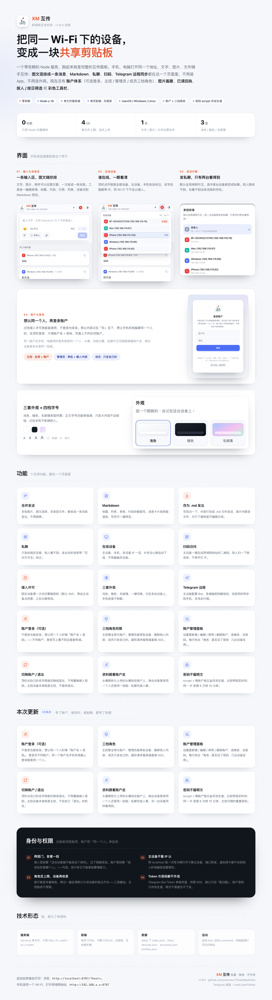

# XiaoMao 互传



> 当前版本：**v1.6.0** · [更新日志](CHANGELOG.md)

## 目录

- [特性](#特性)
- [快速开始](#快速开始)
- [权限模型](#权限模型)
  - [发送权限：两层叠加](#发送权限两层叠加)
- [账户与登录](#账户与登录)
  - [角色与权限](#角色与权限)
  - [主控：账户的唯一管理者](#主控账户的唯一管理者)
  - [接入密码 vs 账户密码](#接入密码-vs-账户密码)
- [设置面板](#设置面板)
- [临时提权（专属密码）](#临时提权专属密码)
- [接入许可](#接入许可)
  - [隐藏密码：免确认自动接入](#隐藏密码免确认自动接入)
- [扫码访问](#扫码访问)
- [合并发送（图文混排）](#合并发送图文混排)
- [Markdown 与快捷输入](#markdown-与快捷输入)
- [存成 .md 文件发送](#存成-md-文件发送)
- [浏览、搜索与批量下载](#浏览搜索与批量下载)
  - [搜索与筛选](#搜索与筛选)
  - [分页懒加载](#分页懒加载)
  - [断线自感知](#断线自感知)
  - [批量打包下载（ZIP）](#批量打包下载zip)
- [文件去重与自动清理](#文件去重与自动清理)
  - [去重 / 秒传](#去重--秒传)
  - [引用计数回收](#引用计数回收)
  - [过期自动清理](#过期自动清理)
- [手机添加到主屏幕（PWA）](#手机添加到主屏幕pwa)
- [文字长度上限](#文字长度上限)
- [推送到 Telegram（远程查看）](#推送到-telegram远程查看)
  - [主设备：配好机器人](#主设备配好机器人)
  - [其他设备：输入密码解锁](#其他设备输入密码解锁)
  - [发出去是什么样](#发出去是什么样)
  - [网络](#网络)
- [在线设备](#在线设备)
- [主题](#主题)
- [手机上的适配](#手机上的适配)
- [指定可见（私聊）](#指定可见私聊)
- [使用技巧](#使用技巧)
- [配置](#配置)
- [HTTP 接口](#http-接口)
- [目录结构](#目录结构)
- [常见问题](#常见问题)
- [说明](#说明)

同一个 Wi-Fi 下，手机、电脑之间互传**文字、图片、文件**的极简工具。跑一条 Node 命令，其他设备打开网址、输一次接入密码就能用，不用注册、不用装 App、不经过任何服务器。

零依赖，只有 `server.js` + 一个 HTML 页面。

```
┌─────────────┐        ┌──────────────┐        ┌─────────────┐
│  MacBook    │  ───▶  │  局域网 HTTP  │  ◀───  │   iPhone    │
│  (主设备)    │        │   :6767      │        │             │
└─────────────┘        └──────────────┘        └─────────────┘
                          只在你本机
```

## 特性

- **文字 / 图片 / 任意文件**，文件流式落盘，不占内存，单文件上限 4GB
- **合并发送**：一段文字 + 几张图 + 若干文件可以合成**一条**消息，还能「文字 → 图片 → 文字」这样图文混排
- **Markdown**：标题、列表、引用、代码块、表格、链接都能写，消息卡片直接按排版渲染，输入区可一键预览
- **存成 .md 文件发**：写完点一下就打包成 `.md` 文件发出去，图片自动内联，对方下载就是一份可编辑的文档
- **Telegram 远程**：主设备配好 Bot 并**打开开关**，各端输密码解锁后，消息可以顺带发到手机上的 Telegram
- **按设备限权**：每台授权设备可以单独收紧，比如只许它发文字、不许发文件
- **账户体系（含权限）**：主控在「设置 → 账户」里建账户、定角色（主控 / 管理员 / 成员），别人用**账户名 + 密码**登录进来。身份可以是账户也可以是设备——同一个账户在手机和电脑上登录都是同一个人，头像、颜色、消息归属都跟着走；一台设备也能退出后换另一个账户
- **三档角色各管一段**：主控管全局与账户，管理员能审批设备、删除他人内容，成员只能发自己的；**不登录也能收发**（按设备身份），只是拿不到这些管理能力，越权的请求服务端直接 403
- **临时提权**：不在主设备前面时，用专属密码（默认 `xiaomao`）让手边这台设备临时拿到管理能力，不用等谁点头
- **长文兜底**：文字按 UTF-8 字节计量，接近上限就提醒，超了给「改用 .md 发送」的一键出路，不会被静默截断
- **快捷输入**：表情面板、分隔符、标题 / 加粗 / 代码 / 引用 / 列表 / 链接一键插入
- **零依赖**，只需要 Node.js ≥ 18，不装任何 npm 包
- **在线设备列表**：收纳在顶栏右上角，点开就知道谁在线，名字自动带 IP 不重名
- **指定可见**：默认全局域网可见，也可以勾选一台或多台设备私发，发出后还能改可见范围
- **已读回执**：每条消息显示「👁 N 已读」——复制文字 / 下载文件 / 点开看图都算读过，按授权设备去重、重复阅读不重复计数，且**包含发送者本人**；主设备或临时提权设备点开还可见「谁已读」名单
- **消息可编辑**：发送者本人可修改自己发出的、含文字段的消息（图文混排时每段文字各一个编辑框、段数不变，图片 / 文件不可改）；编辑后时间旁出现「已编辑 · 时间」标记，点开可见**修订历史**——摘要直接标出这一版**改了哪里**（红色删除 / 绿色新增，长段自动折叠），点摘要可展开该版本全文，旧版本不丢；别人编辑后你会自动跟着刷新
- **消息引用**：任意消息操作区点「引用」，它会被挂到输入区上方；下一条发出的消息顶部带一张引用卡（显示被引用人与摘要），点引用卡平滑跳回原消息并高亮
- **追加补充**：每条消息下都能「补充」（所有人可接龙说明）——纯追加、不改原文、不重置已读，与「编辑」互不影响；内容支持 Markdown 与表情，也能直接带图片 / 文件；补充人可删掉自己写的那条，别人补充后你会自动跟着刷新
- **按发送人筛选**：顶栏的发送人图标按钮，点开就是设备清单（带头像与勾选态），按消息归属人快速过滤
- **按日期筛选**：顶栏的日期图标按钮，点开是**日历视图**——只有当天确实有内容的日期才可选，带内容数量标记；只能翻到有数据的月份
- **双击收起**：双击消息里的发送者头像，正文 / 图片 / 附件收成「一行预览 + 已收起（文字、N 张图片、N 个文件）· 点击展开」，再双击或用那个按钮展开，不会一片空白；收起和展开时都会把「展开全文」的长文本打回默认折叠状态，不会突然铺满一屏
- **工具栏两行**：`共 N 条内容 … 分类标签` / `搜索 发送人 日期 … 批量选择 清空全部`；四个按钮共用一套彩色胶囊（发送人紫、日期青、批量选择天蓝、清空全部红）：宽屏图标 + 文字，窄屏只留图标，批量选择进入选择模式后底色加深、文案变「退出选择」
- **回到顶部**：长列表滚动后右下角浮出「↑」按钮，点一下平滑滚回顶部
- **接入许可**：陌生设备要输密码 + 主设备点同意才能用，授权永久有效、可随时移除
- **扫码访问**：主设备一键生成二维码，手机扫一下就打开
- **三种主题**：浅色、暗色、毛玻璃
- **权限控制**：主设备可限制其他设备能发什么、能删什么，还能逐台收紧
- **长内容自动折叠**，滚动时输入框吸顶悬浮
- **手机友好**：弹窗会跟着软键盘抬高，按钮不会被输入法挡住；底部留足安全区
- 拖拽添加、截图直接粘贴、上传进度、图片灯箱、一键复制
- **搜索与筛选**：顶栏按关键字（文字 / 文件名 / 发送者）实时过滤，再叠加「全部 / 文字 / 图片 / 文件 / 私聊」分类切换，每个分类带自己的色相小圆点，选中时整颗胶囊染上同色，无结果给空态
- **分页懒加载**：内容攒多了只先渲染最新一屏，滚到底自动续拉，长列表也不卡
- **断线自感知**：轮询连着失败会浮出「连接断开」横幅并降频重试，恢复后自动刷新；切回前台也会立刻补一次
- **手机可添加到主屏幕**：自带 `manifest` + 图标，iOS / Android 都能「加到主屏幕」当 App 打开，全屏无地址栏
- **文件去重 / 秒传**：上传时按内容算指纹，同样的东西只存一份；同样的文件再传一次直接复用，省磁盘也省流量
- **过期自动清理**：设置里可选「保留天数」，到点后消息及其文件自动回收，引用计数归零才真删盘
- **批量打包下载**：勾选多条内容，一键生成 `zip` 下载（服务端自实现，支持中文名 UTF-8）
- 所有数据只存在本机 `data/` 目录，不出局域网

## 快速开始

需要 [Node.js](https://nodejs.org) 18 或更高版本。

```bash
git clone https://github.com/xiaomaoJT/XiaoMaoShare.git
cd XiaoMaoShare
node server.js
```

或者直接双击启动脚本：

| 系统 | 启动 | 停止 |
| --- | --- | --- |
| macOS | 双击 `启动.command` | 双击 `停止.command`，或关窗口 |
| Windows | 双击 `启动.bat` | 双击 `停止.bat`，或关窗口 |
| 任意 | `npm start` | `Ctrl + C` |

启动后终端会直接打印访问地址：

```
  XiaoMao 互传已启动
──────────────────────────────────────────────
  本机     http://localhost:6767/?host=xxxxxxxx
  局域网   http://192.168.1.12:6767   (en0)

  手机连同一个 Wi-Fi，在浏览器里打开上面「局域网」地址
```

把「局域网」那行地址发到手机上打开即可。默认端口 **6767**。

> 「本机」那行带一个 `?host=` 令牌，只在跑服务这台机器上用。打开一次就记住了（写进 `data/host.json`），之后照旧用 `localhost` 也行。

## 权限模型

权限分**两层**，互不替代：

1. **接入许可** ——「这台设备能不能进这个房间」。陌生设备要输接入密码 + 主设备点头（见[接入许可](#接入许可)）。
2. **账户身份** ——「进来之后你是谁、能干什么」。用账户 + 密码登录，角色决定能力（见[账户与登录](#账户与登录)）。

两层各管一段，不是「都过才让用」：

1. **接入许可** ——「这台设备能不能进这个房间」。陌生设备要输接入密码 + 主设备点头（见[接入许可](#接入许可)）。**过了就能用**：看内容、发文字 / 图片 / 文件、发私聊。
2. **账户身份** ——「进来之后你是哪个人」。用账户名 + 密码登录后，身份跟着账户走（多台设备算同一个人），能干什么由角色决定（见[账户与登录](#账户与登录)）。

**登录是可选的增强，不是门槛**：不登录照样能收发，只是这台设备以「设备身份」说话，拿不到任何管理能力——删他人内容、审批设备、改全局设置、管账户都要账户角色。登录之后这些才打开，而且换了设备也还是同一个人。

跑服务的这台机器是**主设备**，用两种方式认出来，跟 IP 无关：

- 地址栏是 `localhost` / `127.0.0.1` 打开的浏览器
- 或者带着主设备令牌打开的（终端里那条 `?host=…`，认一次会记住）

主设备**天然是主控**，不用登录也不能退出登录。其他设备登录后按所登账户的角色行事；用专属密码提权则临时拿到主控能力（见[临时提权](#临时提权专属密码)）。

> 为什么不用 IP 判断：很多 Windows 环境会把局域网请求中转成本机地址（端口转发、虚拟网卡、容器映射），只按 IP 认主设备，别人的电脑会被当成主设备、直接拿到管理权限。

| 能力 | 主控 | 管理员 | 成员 | 未登录设备 |
| --- | --- | --- | --- | --- |
| 查看 / 下载公开内容 | ✅ | ✅ | ✅ | ✅ |
| 发送文字 / 图片 / 文件 | ✅ | ✅ | ✅ | ✅ |
| 发送私聊给指定设备 | ✅ | ✅ | ✅ | ✅ |
| 删除自己发的内容 | ✅ | ✅ | ✅ | ✅ |
| 删除别人发的内容 | ✅ | ✅ | ❌ | ❌ |
| 一键清空全部 | ✅ | ✅ | ❌ | ❌ |
| 审批 / 移除授权设备 | ✅ | ✅ | ❌ | ❌ |
| 单独限制某台设备能发什么 | ✅ | ✅ | ❌ | ❌ |
| 改全局设置 / 配 Telegram | ✅ | ❌ | ❌ | ❌ |
| 建账户、改角色、设密码 | ✅ | ❌ | ❌ | ❌ |
| 生成扫码二维码 | ✅ | ✅ | ❌ | ❌ |

> **未登录设备**（过了接入许可、但没登录账户）照常收发，权限只有最基础那一档：`send / attach / priv`。**管理类能力一律没有**——删别人、批设备、改设置、建账户，接口直接 403。它的身份是这台机器的设备指纹，所以「发给我的私聊」只在这台设备上能看到，换台设备就收不到了。

> \* **编辑**（改自己发出的原文）始终只限发送者本人，管理员也不例外——管理员能删别人的内容，但改不了。
>
> 主控这一列包括**主控设备**（跑服务那台）和**临时提权**的设备。上表是角色的「上限」，成员实际能不能发，还要再过一遍下面的设备级权限。

### 发送权限：两层叠加

**能不能发 = 角色允许 ∩ 全局默认 ∩ 这台设备的独立权限**，主控不受限制。两处都能改：

- **全局默认** → 设置 → **通用**，管的是「其他设备」这个整体，存在 `data/settings.json`
  - **允许其他设备发送** —— 关掉后只有主控能发，其他人只能看和下载
  - **允许发送文字 / 图片 / 文件** —— 分别控制内容类型
- **逐台设备** → 设置 → **设备与权限**，每台授权设备下面一排小开关（允许发送 / 文字 / 图片 / 文件），**点一下立刻生效**，不用保存

逐台开关的几条约定：

- 新授权的设备默认四项全开
- 关掉「允许发送」，那台设备就完全发不了，其余三项会自动显示成关
- 撤销授权时，那台设备的提权和权限设置会一并作废

服务端每条请求都会重新判定，前端藏按钮只是顺手；就算自己造请求 `/api/send`，没有权限也会被 403 打回来。

## 账户与登录

**身份有两种：设备身份，和账户身份。** 过了接入许可，这台设备本身就是一个身份——能收发，但它只代表「这台机器」。账户是用来把「同一个人在几台设备上」说成一件事的：同一个账户在多台设备登录，都是同一个人，消息归属、头像、能管理的范围全跟着账户走。

登录是**可选**的：你想以「某个人」的身份说话、想让几台设备算同一个人、想拿到管理能力，才需要登录。

- 账户由主控在 **设置 → 账户** 里建：填名字、选角色、设密码（至少 4 位）。刚建出来可以不设密码，但**没密码的账户登录会被挡回去**，提示「请让主控设一个密码」
- **登录页只有两个框：账户名 + 密码**，不列任何账户——大厅里不该摆出「这里都有谁」。账户名不存在和密码错误给的是同一句「账户名或密码不正确」，免得被拿来试出有哪些账户
- **不登录也能用**：过接入许可就能收发，只是以这台设备的名义；登录与否随时可以切换，登录页上有「暂不登录，继续使用」的出口
- **换账户**：顶栏点自己的名字 → 「切换账户」；也可以「退出登录」回到设备身份。切换账户不会重置接入许可，不用重新输接入密码
- **主控设备不用登录也退不掉**：它本身就是主控，退出登录的接口会直接拒绝
- **账户被停用 / 删除**：正在用它的设备下一次请求就**退回设备身份**（能用，但私聊和管理能力没了）；删账户会顺手把该账户的头像也清掉
- **只有主控能看到账户清单**（设置 → 账户）；其他设备连接口都拿不到这份名单
- **密码只存派生值**：`scrypt` + 每账户独立盐，明文不落盘也不下发；登录连错 6 次，这个 IP 锁 10 分钟
- **资料跟着账户走**：头像颜色 / 上传的图存在账户身上（`data/profiles.json` 的键是账户 id），所以换台设备登录同一个人，看到的还是同一个头像；没登录的设备仍按设备指纹临时记一份

### 角色与权限

三档角色，能力一层含一层：

| | 主控 owner | 管理员 admin | 成员 member |
| --- | --- | --- | --- |
| 发消息 / 传文件 | ✅ | ✅ | ✅ |
| 只发给指定的人 | ✅ | ✅ | ✅ |
| 删除他人内容、清空全部* | ✅ | ✅ | ❌ |
| 审批设备、逐台限权 | ✅ | ✅ | ❌ |
| 改全局设置、配 Telegram | ✅ | ❌ | ❌ |
| 建 / 改 / 删账户 | ✅ | ❌ | ❌ |

服务端把角色折成一组能力位（`send / attach / priv / moderate / devices / config / accounts`），每个接口进去先过一遍；前端只是照着同一份能力决定显示什么，不承担安全职责。

### 主控：账户的唯一管理者

- **只有一个主控**：首次启动自动创建「主控」账户。它的角色不能改、不能停用、不能删除，也不会被提第二个
- 别的账户想升成主控会被拒绝（`已经有主控账户了，不能再提一个`）
- 主控账户默认**没有密码**，只能在本机（主控设备）上用；想让别人用这个账户登录，先给它设个密码
- 账户页每行显示「角色 · 已设密码 / 还没设密码 · N 台设备在用」，并带「我」标记，一眼看出谁是谁

> 忘了主控密码又进不去主设备？停掉服务，删掉 `data/accounts.json` 里那个 `"role": "owner"` 的条目的 `salt` / `hash` 两个字段（或整个删掉 `data/accounts.json`），重启后会重新建一个无密码的主控账户——其他账户和内容都不受影响。

### 接入密码 vs 账户密码

两个密码管两件事，别混着给：

| | 接入密码 | 账户密码 |
| --- | --- | --- |
| 管什么 | 这台设备**能不能进这个房间** | 进来后**你是谁** |
| 谁设的 | 启动时用环境变量定（默认 `XM` / 隐藏密码 `XiaoMao`） | 主控在设置 → 账户里逐个设 |
| 什么时候要 | 新设备第一次访问 | 每次登录 / 换账户 |
| 记住吗 | 记住，授权永久有效 | 不记住；换账户要重新输 |

## 设置面板

右上角齿轮（没提过时是盾牌）打开，左边竖排导航、右边内容，**五个页签**：

| 页签 | 内容 |
| --- | --- |
| **通用** | 其他设备的默认发送权限；提权状态下这里还能「退出提权」 |
| **设备与权限** | 待审批列表、已授权设备的逐台权限开关、撤回授权、移除同 IP 设备、全部撤销 |
| **账户** | 建 / 改 / 删账户，选角色、设密码、停用；只对主控可见 |
| **Telegram** | Bot Token、接收人 ID、总开关、发送测试 |
| **外观** | 三套主题色板 + 四档正文字号 + 自定义头像 |

菜单按身份收放：主控看到全部五页；**管理员**只有 **设备与权限 / 外观**（也没有「保存」按钮，全局设置服务端本来也不让改）；**成员**点齿轮走的是「专属密码临时提权」那条路，不会进到这个面板——想调主题和字号直接用顶栏的主题按钮。弹窗标题会跟着身份变，不会让人点进去才发现没权限。

窄屏（≤ 640px）会自动把左侧导航变成顶部横向滚动的分段条，不用侧滑也能换页。「保存」只保存 **通用** 页的开关，其余四页都是即时生效。

内容多时只有右半边滚动，标题和底部按钮始终留在视口里；手机上则是从底部升起的抽屉。

## 临时提权（专属密码）

主设备管理着一切，但主设备不一定就在手边。**专属密码**就是为了解决「我想在这台手机上改点设置」：

顶栏右侧的**盾牌图标**（非主设备时显示）→ 输入专属密码 → 直接拿到管理能力，**不用主设备二次确认**。提权后图标变成齿轮，在线设备列表里这台会带上 `提权中` 标记。

- 默认密码 **`xiaomao`**，改法：

  ```bash
  ELEVATE_PASSWORD=换一个 node server.js      # macOS / Linux
  set ELEVATE_PASSWORD=换一个 && 启动.bat      # Windows
  ```

- **8 小时内有效**，到期自动失效
- 只能在**已经通过接入许可**的设备上用：审批还没过，提权接口也是 403
- 提权**只给管理能力，不解开内容发送限制** —— 那台设备原来不许发文字，提权后照样不许
- 主设备端 设置 → **通用** 页里有「退出提权」，随时交回；不放心也可以连带撤销该设备的授权
- 密码连错 5 次，这个 IP 会被锁 10 分钟
- 提权名单存在 `data/elevated.json`（键是设备指纹）

> 接入密码（`XM`）管「能不能进得来」，专属密码（`xiaomao`）管「进来之后能不能改设置」——两个密码职责分开，不要把接入密码随便给人。

## 接入许可

默认就开着：**陌生设备第一次访问，必须输入密码，并由主设备点「同意」才能用**（另有隐藏密码可免确认直接接入，见下文）。**

1. 对方扫码或打开地址，页面只有一个输入框，提示「需要接入许可」
2. 输入接入密码（默认 **`XM`**），点「申请接入」
3. 页面变成「等待主设备确认」，每 2 秒自动查一次状态
4. 主设备这边，右上角齿轮上会出现红点，进去在 **设备与权限** 页点 **同意**（或拒绝）
5. 通过后对方页面自动进入，无需刷新

授权是**按设备指纹记账的**（浏览器里存一串随机 id，每次请求带上），**跟 IP 无关**：

- 同意之后永久有效，不用每次重新验证
- **多台设备可以同时在线**：同一个 IP 上挂几台都一样（端口转发 / 代理 / 网关让所有设备共用一个来源 IP 时，也不会互相顶掉）
- 同一个 IP 换了新设备**不会**自动放行 —— 指纹对不上就重新验证
- 主设备可随时「移除」，那台设备下一次请求就被挡回去，要重新输密码并再次确认
- 设备多的时候可以点「全部撤销」一次性清空，所有设备重新验证
- 同一个 IP 上堆出一串历史设备（清过浏览器数据 / 换过浏览器 / 重装过系统，旧指纹再也回不来）时，点「移除同 IP 设备」只留最近活跃的一台，其余一次清掉
- 被拒绝的设备会看到「主设备没有同意」，可以重新申请
- 清除浏览器数据 / 换浏览器 = 变成一台新设备，要重新验证

> 早期版本按 IP 记授权，会出现两个问题：同 IP 换设备「继承」授权，以及同 IP 多设备**互相覆盖**（后登录的把那台顶掉）。升级后启动时会自动作废这类旧记录，并打印在终端里。

### 隐藏密码：免确认自动接入

除了上面「输入 `XM` → 主设备同意」这条常规路径，还有一个**隐藏密码**（默认 **`XiaoMao`**）：新设备输这个密码，服务端会**直接把它写进授权名单并放行**，不再需要主设备去点「同意」。

- 走普通密码 `XM` 进入的是「待审批」，要等主设备点头；走隐藏密码 `XiaoMao` 是「秒进」，授权名单上这台会带 `auto` 标记，方便你之后想撤销时认得出来
- 它本质上是**绕过主设备确认的后门**——任何知道这个密码的设备都能直接接入，所以当作管理员级密码保管，别随便告诉局域里无关的人
- 想换掉就用环境变量 `SHARE_AUTO_PASSWORD`，不碰代码也能改

```bash
SHARE_AUTO_PASSWORD=换一个 node server.js      # macOS / Linux
set SHARE_AUTO_PASSWORD=换一个 && 启动.bat      # Windows
```

改密码：

```bash
SHARE_PASSWORD=my-secret node server.js      # macOS / Linux
set SHARE_PASSWORD=my-secret && 启动.bat      # Windows
```

授权名单存在 `data/devices.json`（一台设备一条，键是设备指纹），删掉这个文件等于清空所有授权（所有设备都要重新验证）。终端启动时也会把当前已授权的设备列出来。

## 扫码访问

主设备点右上角的二维码按钮，弹出当前局域网地址的二维码：

- 手机扫码直接打开这个互传页面，省得手打 IP
- 电脑有多块网卡（有线 + Wi-Fi）时，可以用下面的小标签切换地址
- 「复制链接」可以贴到聊天里发给别人

对方扫码后走「输入密码 → 主设备同意」这一步；若你知道隐藏密码 `XiaoMao`，输它即免确认直接接入。

## 合并发送（图文混排）

输入区是按顺序排的「块」：文字块和附件块。你按什么顺序放，发出去就是什么顺序，**整条消息一起发**。

几个典型用法：

- **多张图片发一条**：连选几张图 → 一条消息里九宫格排列，点开看大图
- **多类型文件一起发**：图片 + PDF + 压缩包混着选，一条消息里逐行列出来，各自下载
- **图文混排**：先写一段话 → 插入图片 → 图片后面会出现新的输入块，接着写 → 再插一个文件 → 再写……发出去就是「文字 / 图片 / 文字 / 文件 / 文字」

操作方式：

- 点「文件 / 图片」多选，或直接把文件拖进页面，或截图后 `⌘V` / `Ctrl+V`
- 每个附件块的右边有 `✕`，发之前可以单个移除
- 附件在加入时就并行上传，块上显示百分比；全部传完点「发送」
- 有附件没传成功时（比如选的文件被移走了），块会标红，此时发送会提示你处理，不会悄悄少发

附件顺序就是块的顺序；同一条消息最多 30 个附件。

## Markdown 与快捷输入

文字块支持 Markdown，写的时候是纯文本，发出去按排版渲染；对方看到的和你在「预览」里看到的一样。

支持的语法：

| 写法 | 效果 |
| --- | --- |
| `# 标题` ~ `###### 标题` | 六级标题 |
| `**加粗**`、`*斜体*`、`~~删除线~~` | 强调 |
| `` `行内代码` `` | 灰底等宽，适合命令、变量名 |
| ` ```js ... ``` ` | 代码块，带头部语言标签和「复制」按钮 |
| `- 项目` / `1. 项目` | 无序 / 有序列表 |
| `> 引用` | 引用块 |
| `\| 表格 \|` | 表格（第二行写 `\| --- \| --- \|`） |
| `---` | 分隔线 |
| `[文字](https://…)`、裸链接 | 可点链接（只放行 http/https/mailto） |

输入区下方一排按钮，光标停在哪一段就插到哪一段：

- 😊 **表情** —— 常用 / 物件 / 符号三组，手机上从底部弹出，可连续插入
- **格式**（窄屏才有）—— 屏幕放不下时，下面这些格式按钮会收进这个面板，点开是一格一格的按钮
- **— 分隔** —— 插一条水平分隔线
- **H / B / I** —— 标题、加粗、斜体，再点一次取消
- **`</>` / `{ }`** —— 行内代码、代码块
- **❝ / • 列表 / 🔗 链接** —— 引用、列表、链接（选中文字再点，直接包成链接）
- **预览** —— 切到渲染后的样子，点「编辑」回去接着写
- **`↓ .md`** —— 把当前内容打包成 `.md` 文件发出去（见下一节）

手机上工具条不会横向溢出：只有 😊、格式、预览、`.md` 四个动作，其余都在「格式」面板里。

没选中文字时，加粗 / 代码这类会给一段占位文字并选中它，直接输入就替换掉，不用自己数星号。

## 存成 .md 文件发送

写完直接点工具条右侧的 **`↓ .md`**，输入区的内容会被打包成一个 `.md` 文件，作为一条文件消息发出去 —— 不再是一段滚动的聊天记录，对方下载下来就是能直接编辑的 Markdown 文档。

- **文件名取第一行**：第一行写 `# 局域网互传周报`，文件就叫 `局域网互传周报.md`；没有可用标题时用 `XiaoMao-笔记-年月日-时分.md`；文件名里不能用的字符（`\ / : * ? " < >`）会自动去掉
- **图片内联**：输入区里插的图片会以 data URI 写进文件，一个 `.md` 就是完整的图文文档，Typora / Obsidian / VSCode 打开都能看到图。内联总量超过 8MB 的图片退回成普通附件，跟 `.md` 一起发
- **其他附件跟发**：`.md` 里留一行引用（`> 附件：xxx.pdf`），文件本身作为同一条消息的一部分一起发过去
- **失败不丢内容**：上传或发送失败时输入区原样保留，处理完直接重试

下载时是 `text/markdown` + `attachment`，浏览器直接存盘，不会在标签页里摊开一堆源码。

## 浏览、搜索与批量下载

内容多了之后，列表本身也是个能用的工具。

### 搜索与筛选

顶栏的搜索框实时匹配：消息里的**文字、文件名、发送者昵称**都算。旁边还有一排分类标签 —— **全部 / 文字 / 图片 / 文件 / 私聊** —— 可以叠加在搜索结果上。两者都不命中时给一个空态提示，不会露出一片空白。

筛选和搜索都是**纯前端**的，不会额外打接口；服务端返回的完整列表缓存在本地，只是换个视图看。

### 分页懒加载

`/api/list` 一次把可见内容都给到，但前端**首屏只渲染最新一屏（约 20 条）**，往下滚到底再用 `IntersectionObserver` 续拉下一屏。图片都带 `loading="lazy"`，几千条也撑得住。

### 断线自感知

轮询（`/api/list`）连续失败会浮出一条「连接已断开，正在重试」的横幅，并把轮询频率降下来省电；一旦恢复立刻刷新列表并收起横幅。手机切到后台再回来，也会在 `visibilitychange` 时补一次同步，不会让你对着旧列表发呆。

### 批量打包下载（ZIP）

点顶栏的 **批量选择**，每张卡片左上角出现一个勾，点卡片即可切换选中；选好后在底部条点 **打包下载 ZIP**，服务端把选中的内容（及其文件）打成 `zip` 一次下发。

- zip 走 **store 模式**（不压缩，纯拼接），服务端零依赖自实现，支持中文文件名（`General Purpose Bit` 标 UTF-8 标记，Windows / macOS 解压中文名不乱码）
- 只有被选中的消息里**确实带文件**的才会进包；纯文字消息不会凭空造文件
- 权限同列表：只能打包你**看得到**的内容（私聊只打包收发双方可见的那部分）

## 文件去重与自动清理

### 去重 / 秒传

上传时按内容算 SHA-256 指纹。同一份文件（哪怕改了名、转过手）只会落盘**一份**；再传一次直接复用已有的那份，既省磁盘也省上传流量。指纹索引在服务端内存里维护，重启后由已落盘文件重建。

### 引用计数回收

一份磁盘文件可能被多条消息引用（去重后常发生）。删除某条消息时，服务端数一下还有没有别处指着它，**还有引用就不删盘**；只有当引用计数归零，文件才真正从 `data/files/` 清掉。所以「删一条」不会误伤另一条里同样的附件。

### 过期自动清理

设置面板 → **通用** 页里有「保留天数」（`keepDays`）：

- `0`（默认）= 不自动清理，留着直到手动清
- `7` / `30` / 自定义 = 超过这个天数的消息连同它们的文件一起回收，每天定时扫一次（也会在启动时扫）

清理同样遵循引用计数：被别处引用的文件不会因一条过期就被删。

## 手机添加到主屏幕（PWA）

项目带 `manifest.webmanifest` 和 `icon.png` / `apple-touch-icon.png`。在 iOS Safari「分享 → 添加到主屏幕」、或 Android Chrome「安装应用」后，会以**全屏、无地址栏**的方式打开，像个原生 App。主题色跟随当前皮肤。

## 文字长度上限

文字一律按 **UTF-8 字节**计量（中文一个字 3 字节），不是按字符数：

| 项 | 值 |
| --- | --- |
| 单个文字片段 | 400 KB（约 13 万汉字） |
| 一条消息的文字总量 | 512 KB |
| 开始提醒 | 48 KB 起，输入区出现长度徽标 |

输入时会实时显示 `已输入 / 上限`；接近上限给出「考虑改用 .md」的黄色提示，**超了就把发送按钮锁掉**，同时在输入区下方弹出一条带按钮的提示：

> 这条消息的文字共 xxx KB，超过单条上限 512 KB。**建议改用「存为 .md」发送** —— 打包成文件后不受这个长度限制。

点一下就自动导出发送，不用手动清理输入区。

服务端这边做两件事：

- **不再静默截断。** 以前超过上限会默默砍掉后半段，你以为发全了其实没有；现在直接返回 `413`，并说明是哪一段太长
- **不再掐连接。** 以前请求体超限就直接 `destroy()`，浏览器只能看到一个没有正文的 `Failed to fetch`（也就是「发送失败 / 加载失败」却说不清原因）；现在会先把请求读完，然后正常回一个 JSON 错误

> 这两条加起来就是「超长文本发送失败」的根因：既拿不到报错，内容还可能被悄悄截掉。

## 推送到 Telegram（远程查看）

人不在电脑边也能收到消息：主设备配一个机器人，**并打开开关**，之后在任意设备发的消息都可以顺手同步到手机的 Telegram 里。

> **默认是关的。** 没在设置里打开「启用 Telegram 转发」之前，各设备的 TG 按钮**完全不显示**，不会出现「配也没配、按钮却在」的困惑。

### 主设备：配好机器人

1. 在 Telegram 里找 **@BotFather**，发 `/newbot`，按提示起名，会拿到一串 Token（形如 `123456789:AAH…`）
2. 找 **@userinfobot** 发条消息，它会回你的数字 ID（想发到频道就填 `@频道用户名`，记得先把机器人拉进频道）
3. 打开 **设置 → Telegram**，填入 Token 和接收人 ID，**打开「启用 Telegram 转发」**，点 **保存配置**
4. 再点 **发送测试**，手机收到「🤖 XiaoMao 互传 · 测试消息」就算通了

保存时会先调一次 `getMe` 校验 Token，填错直接报错、不会存进去。Token 只存在 `data/telegram.json`（权限 `600`，且 `data/` 不进 git），**永远不会下发给其他设备**——它们只知道「能不能用、是哪个 bot」。

**关掉开关**：配置保留，所有设备的按钮立刻消失；重新打开就能接着用。

### 其他设备：输入密码解锁

配好且启用之后，输入区左侧才会出现**纸飞机按钮**（虚线边框 = 还没解锁）。点它输入接入密码（默认 `XM`），解锁后按钮变蓝；再点一下就是开 / 关。

- **蓝色** = 这条消息会同步到 Telegram；**再点一下**关掉，就只发局域网
- 解锁状态跟在设备上，**只对那台设备有效**；重启服务要重新输一次密码
- 真正的闸门在服务端：没解锁的设备就算自己造请求，`/api/tg/push` 也会 403
- 密码连错 5 次，这个 IP 会被锁 10 分钟

### 发出去是什么样

- 文字 → `sendMessage`，开头带发送者名字，例如 `📨 iPhone (192.168.1.23)`
- 图片 → `sendPhoto`，原图发过去
- 其他文件（包括「存为 .md」导出的文档）→ `sendDocument`
- 一条消息里文字和附件都有时，先发文字再逐个发附件，顺序和输入区一致；单条最多带 6 个附件，多出来的会在提示里说明
- 私聊消息开头会标一句「仅 xxx 可见」

同步失败**不影响本地发送**——消息已经在局域网里了，只是提示一句「Telegram 没发出去：接收人 ID 不对，或对方还没跟机器人说过话」。

### 网络

服务端直连 `api.telegram.org`，国内网络一般要让它走代理。Node 自己不认 `HTTPS_PROXY` 环境变量，这里手动实现了 CONNECT 隧道：

```bash
HTTPS_PROXY=http://127.0.0.1:7890 node server.js
```

用的是本地代理的 HTTP 端口（Clash / Surge 那类工具默认都开一个）。不通的时候提示会直说「代理连不上：地址或端口不对」「连不上 api.telegram.org，可能需要代理」，不会干转圈。

## 在线设备

在线设备收纳在**顶栏右上角**：按钮里叠着几个设备头像，旁边的数字是在线台数（窄屏只留头像，把顶栏空间让给标题）。

点开是一个浮层，列出当前所有打开着页面的设备，主设备带橙色 `主设备` 标记、临时提权的设备带 `提权中` 标记、自己那台带 `本机`。点按钮以外的地方、按 `Esc`、或者滚动页面都会自动收起；手机上浮层自动撑满屏幕宽度，不会顶出视口。

命名规则自动生成，保证不重名，都带 IP：

- **登录了账户**：直接显示账户名（例如「小美」），消息归属、头像、可删范围全都按账户算
- **主设备**：机器名 + 内网 IP，例如 `Maos-MacBook (192.168.1.12)`
- **其他设备（未登录）**：设备型号 + IP，例如 `iPhone (192.168.1.23)`、`Windows (192.168.1.31)`

没登录时点顶栏的设备名可以改成自己喜欢的名字（改的是这台设备的名字），留空恢复自动名；登录后改的是**账户名**（同账户的设备一起变）。超过 8 秒没有心跳的设备会自动从列表移除。

## 主题

右上角圆形按钮切换，三套主题：**浅色**、**暗色**、**毛玻璃**。选择记在各自设备上（localStorage），互不影响。首次打开跟随系统的深色 / 浅色偏好。

毛玻璃会实时模糊背景，代价是文字压不住后面的渐变。所以这套主题额外做了几件事：卡片不透明度调到 0.74、按钮 / 输入框 / 标签统一用一层更实的底色（`--fill`）、图片和代码块强制不透明底、顶栏的模糊强度再高一档。**不支持 `backdrop-filter` 的浏览器**（部分安卓内置浏览器）会自动降级成实色浅色主题，不会出现「模糊没生效、字反而糊了」的情况。

### 字体大小

同一处外观设置里还有四档字号：**小（0.92）/ 标准（1）/ 大（1.12）/ 特大（1.26）**。它只放大**内容**——消息正文、补充、引用摘要、文件名与时间；按钮、图标、工具栏尺寸不变，免得整页一起胀大。实现上是一个倍率变量 `--tfs`，正文相关规则写成 `calc(14.5px * var(--tfs))`，行高用了比例值（1.62 / 1.66），会跟着字号一起长，不会挤成一片。选择同样只记在本机。

### 头像

顶栏点自己的设备名，就能进「头像与昵称」：改名字、挑头像颜色、或者直接传一张图。

- **颜色**：12 色可选。打开时默认选中**还没被别人用过的颜色**（色块右上角有绿点），一排人放一起也不会糊成一片同色。
- **上传图片**：前端先做方形居中裁切并缩到 160×160，再以 base64 传给 `/api/me/profile`；服务端落到 `data/avatars/<cid>-<ts>.jpg`，用 `/a/<cid>?v=<版本号>` 输出（版本号破缓存）。
- 头像**跟着身份走**：登录了就记在账户上（`data/profiles.json` 的键是账户 id），换台设备登录同一个人，看到的还是这张脸；没登录的设备按指纹临时记一份。消息卡片、补充、在线设备、已读列表、发送人筛选、发送对象都会用上它；没设过的仍按名字哈希取色兜底。
- 「恢复默认」清掉自选色与上传图，回到哈希取色。

## 手机上的适配

- **软键盘**：用 `visualViewport` 量出被输入法吃掉的高度，实时顶起弹窗，底部按钮不会被盖住
- **安全区**：弹窗抽屉、底部提示、页脚都叠加了 `env(safe-area-inset-bottom)`，避开手势条 / 导航条
- **窄屏工具条**：装不下 9 个格式按钮时收进底部的「格式」抽屉，输入区不会横向溢出
- **弹窗形态**：窄屏自动变成从底部升起的抽屉，操作区够得着

## 指定可见（私聊）

输入框左边的「所有人」按钮用来选择发送对象：

- **所有人**（默认）—— 同一局域网下打开页面的设备都能看到
- **指定设备** —— 勾选一台或多台已授权设备（含当前离线、上线后才能看的），只有你和被勾选的设备能看到，其他设备的内容列表里根本不会出现这条

发送对象支持**多选**：可以一次性勾好几台设备，按钮上会显示「N 台设备」。选择器里列出的是**全部已授权设备**，不限于当前在线的。

**发出后还能改可见范围**：每条消息卡片（发送者本人或主设备可见）右上角的眼睛按钮，可以重新点开同一套选择器修改谁能看；改完后其他设备下一轮刷新会自动按新规则过滤。

指定可见的内容会带上橙色 `指定可见` 标记（悬停能看到接收方名字）。发送对象只对本次发送生效，发完仍然停在当前选择上，改动前一直沿用。

由于可见范围按**身份**识别（账户 + 设备指纹，都存在各自浏览器里），同一个账户在另一台设备上登录也能看到发给他的内容；但如果对方清除了浏览器数据、又没有账户，之前指定给他的内容他自己就看不到了。

## 使用技巧

- **拖拽**：把文件直接拖进页面任意位置，会加进当前这条消息
- **粘贴**：截图后直接 `⌘V` / `Ctrl+V`，作为附件插入输入区
- **发送**：`⌘/Ctrl + Enter` 快捷发送（文字和附件一起发出去）
- **长内容**：超过约 7 行的文字默认折叠，点「展开全文」查看
- **写长了怎么办**：看不见就没关系；一旦超过 48KB，旁边会冒出长度徽标，超了就点提示里的「改用 .md 发送」，别硬发
- **删附件**：点附件右侧 `✕`；或者在下一个文字块段首按 `Backspace`，直接把上面那个附件删掉
- **改顺序**：附件插在光标所在段落之后，先把光标放到想要的位置再选文件即可
- **滚动**：往下翻时输入框会吸顶悬浮，随时可以继续发
- **纯键盘**：Tab 可以在文字块和按钮之间切换，附件块的 `✕` 也可以 Tab 到

## 配置

| 项 | 说明 |
| --- | --- |
| `PORT` | 端口，默认 `6767`。被占用会自动顺延 +1 |
| `SHARE_PASSWORD` | 陌生设备的接入密码，默认 `XM` |
| `SHARE_AUTO_PASSWORD` | 隐藏密码，输它即免主设备确认直接接入，默认 `XiaoMao` |
| `ELEVATE_PASSWORD` | 临时提权的专属密码，默认 `xiaomao` |
| `data/files/` | 上传的文件原样存放 |
| `data/index.json` | 内容索引（一条消息含多个片段） |
| `data/settings.json` | 权限设置（全局默认） |
| `data/devices.json` | 已授权的设备名单（含每台设备的独立权限、当前登录的账户） |
| `data/accounts.json` | 账户表（名字、角色、密码派生值与盐、停用状态、最后登录时间） |
| `data/profiles.json` | 头像颜色 / 头像版本（键是账户 id，未登录的设备用指纹） |
| `data/avatars/` | 上传的头像图片（`/<accountId>-<ts>.jpg`） |
| `data/elevated.json` | 当前处于提权状态的设备（8 小时后自动失效） |
| `data/host.json` | 主设备令牌（权限 600，删掉会重新生成一条） |
| `data/telegram.json` | Telegram 的 Token 与接收人（权限 600，不会下发） |
| `HTTPS_PROXY` | 访问 Telegram 时走的代理，例如 `http://127.0.0.1:7890` |

自定义端口：

```bash
PORT=9000 node server.js         # macOS / Linux
set PORT=9000 && 启动.bat         # Windows
```

想清空所有内容：页面右上角「清空全部」，或直接删掉 `data/` 目录。

## HTTP 接口

服务端有账户体系：权限 = **接入许可**（这台设备能不能进）× **账户角色**（进来后是谁）。除标注外，以下接口都要求**已通过接入许可**，否则 401。

两个术语：

- **主控** —— 主控设备、临时提权的设备、或登录了主控账户的设备（`canConfig`）
- **管理层** —— 主控 + 管理员（`canManage`）

| 方法 | 路径 | 说明 |
| --- | --- | --- |
| `GET` | `/` | 页面 |
| `GET` | `/api/info` | 机器名、端口、局域网地址、当前设备的授权状态 |
| `POST` | `/api/hello` | 上线 / 心跳，返回授权状态、设备名、在线列表、`caps`、`role`/`roleName`、`acc`、`accounts`、`limits` |
| `POST` | `/api/auth` | 提交接入密码 `{ password, cid }`；普通密码 `XM` 进入待审批，隐藏密码 `XiaoMao` 直接写入授权并放行 |
| `POST` | `/api/login` | 登录账户 `{ cid, acc, password }`，成功后这台设备就代表该账户；账户不存在 404、已停用 / 没设密码 / 密码错 403、连错 6 次 429 |
| `POST` | `/api/logout` | 退出登录 `{ cid }`，这台设备回到未登录（接入许可仍在）；主控设备上会被拒绝 |
| `GET` | `/api/accounts` | 账户清单；主控拿到全部（含已停用），其他人只拿到未停用的那些（没设密码的也在列表里，但登录按钮是灰的） |
| `POST` | `/api/accounts` | 新建 / 修改账户 `{ id?, name, role?, password?, disabled?, clearPass? }`（仅主控） |
| `DELETE` | `/api/accounts?id=` | 删除账户，正在用它的设备退回未登录（仅主控；主控账户不可删） |
| `GET` | `/api/devices` | 授权名单 + 逐台权限 + 待审批列表 + 提权名单，每台带当前登录账户（管理层） |
| `GET` | `/api/devices-lite?cid=` | 已授权设备清单（任意已授权设备可拉，供选接收人，不含待审 / 被拒） |
| `POST` | `/api/devices/approve` · `/api/devices/reject` | 同意 / 拒绝某台设备 `{ cid }`（管理层） |
| `DELETE` | `/api/devices?cid=` | 移除某台设备的授权（管理层；主控设备不可移除） |
| `DELETE` | `/api/devices?all=1` | 撤销全部授权（管理层） |
| `DELETE` | `/api/devices?dupes=1` | 同一 IP 只保留最近活跃的一台，其余授权移除（管理层） |
| `POST` | `/api/devices/perms` | 设某台设备的发送权限 `{ cid, perms: { send, text, image, file } }`（管理层） |
| `POST` | `/api/elevate` | 用专属密码临时提权 `{ cid, password }` |
| `POST` | `/api/elevate/off` | 交回提权 `{ cid }` |
| `GET` | `/api/qr?ip=&px=` | 生成访问地址的二维码，返回 SVG（管理层） |
| `POST` | `/api/me/profile` | 改自己的名字 / 头像颜色 / 上传头像 `{ cid, name?, color?, avatar? }`，`avatar` 传空清掉；登录状态下改的是**账户名**与账户资料（同账户设备一起变） |
| `GET` | `/a/<key>?v=` | 输出头像图片，`key` 是账户 id（未登录设备用 cid） |
| `GET` | `/api/list?cid=` | 内容列表 + 在线设备 + `caps` + `role`/`acc` + `limits`（兼作心跳，已按私聊可见性过滤） |
| `GET` | `/api/zip?ids=<逗号分隔的消息 id>&cid=` | 把选中的消息（含其文件）打包成 `zip` 下载；加 `&probe=1` 只返回 `{ count, size }` 预检 |
| `GET` | `/manifest.webmanifest` | PWA 清单（未授权也能拿） |
| `POST` | `/api/upload?name=&type=&cid=` | 上传到暂存区，**请求体即文件二进制**，返回 `{ part, deduped }`；内容已存在时 `deduped: true` 并复用磁盘文件 |
| `POST` | `/api/send` | 合并发送，`{ cid, to, parts: [...] }`，见下；`to` 为 cid 数组（留空数组 = 全网可见）；文字超限时返回 `413 { error, tooBig: true }` |
| `GET` | `/f/:fid` | 预览（图片 / 视频 / PDF 内联） |
| `GET` | `/f/:fid?dl=1` | 以附件下载 |
| `DELETE` | `/api/item?id=&cid=` | 删除一条消息（连同里面的所有文件）；只能删自己的（同账户算自己），管理层可删任何人的 |
| `POST` | `/api/item/visibility` | 改一条消息的可见范围 `{ cid, id, to: [...] }`，仅发送者或管理层可改 |
| `POST` | `/api/item/note` | 给某条消息追加补充 `{ cid, id, parts }`（文字段 + 附件段，兼容只传 `text`） |
| `POST` | `/api/item/note/del` | 删掉自己写的一条补充 `{ cid, id, noteId }` |
| `DELETE` | `/api/all` | 清空全部（管理层） |
| `POST` | `/api/rename` | 改设备名 `{ cid, name }`，留空恢复自动名（登录状态下会改到账户名上） |
| `POST` | `/api/settings` | 改全局默认权限 `{ allowSend, allowText, allowImage, allowFile, keepDays }`（仅主控） |
| `POST` | `/api/tg/config` | 配 Telegram `{ token, chatId, enabled }`，token 会先 `getMe` 校验（仅主控） |
| `POST` | `/api/tg/test` | 给接收人发一条测试消息（仅主控） |
| `POST` | `/api/tg/unlock` | 用接入密码解锁本机的 Telegram 发送 `{ cid, password }` |
| `POST` | `/api/tg/lock` | 关掉本机的解锁状态 `{ cid }` |
| `POST` | `/api/tg/push` | 把某条消息同步到 Telegram `{ cid, id }`，未解锁 403 |
| `POST` | `/api/text` | 只发文字（老接口，等价于 `parts` 里只有一个文字片段） |

越权时统一返回 `403 { error }`，文案是给人看的（比如未登录设备去删别人的消息会收到「只能删除自己发送的内容」，去改设置会收到「没有管理权限，只有主控能改全局设置」）。

一条消息的结构是**有序片段数组**，文字和附件可以任意交替：

```jsonc
// POST /api/send
{
  "cid": "c1a2b3c4d5e6f7a8",
  "to": [],                       // 留空数组 = 全网可见；填 cid 数组 = 指定可见（多选）
  "parts": [
    { "type": "text", "text": "第一段文字" },
    { "type": "file", "fid": "mvm7x22qcb0394" },   // 来自 /api/upload 的 part.fid
    { "type": "text", "text": "图片后面接着写" }
  ]
}
```

`/api/hello` 和 `/api/list` 会额外带回两个字段，前端据此决定 UI 呈现，不用自己推规则：

```jsonc
{
  "caps":   { "send": true, "text": true, "image": true, "file": false },  // 这台设备实际能发什么
  "limits": { "textBytes": 409600, "textTotal": 524288, "warnBytes": 49152 }
}
```

先把文件传到 `/api/upload` 拿到 `fid`，再用 `/api/send` 一次组装成一条消息。暂存区里的文件 30 分钟没被发送会自动清理；发送时如果有 `fid` 已失效，接口会返回 `409` 而不是悄悄少发。

所有 `readBody` 超限的场景都会返回 `413` 而不是掐断连接 —— 掐断的话浏览器只能看到一个没有响应体的 `Failed to fetch`，排查时非常难判断。

## 目录结构

```
XiaoMaoShare/
├── server.js              # 全部服务端逻辑，零依赖
├── public/
│   ├── index.html         # 单页界面（内联 CSS / JS）
│   ├── logo.gif           # 顶栏动图 logo
│   ├── icon.png           # 图标 / favicon
│   ├── apple-touch-icon.png
│   └── manifest.webmanifest  # PWA 清单，手机「添加到主屏幕」用
├── 启动.command / 停止.command   # macOS
├── 启动.bat / 停止.bat           # Windows
├── data/                  # 运行时数据，已被 .gitignore 忽略
│   ├── files/             # 上传的原始文件
│   ├── index.json         # 消息索引（每条含有序片段）
│   ├── settings.json      # 权限设置（全局默认）
│   ├── devices.json       # 已授权设备 + 每台设备的独立权限 + 当前登录账户
│   ├── accounts.json      # 账户表（名字 / 角色 / 密码派生值 / 停用状态）
│   ├── profiles.json      # 头像颜色与头像版本（键是账户 id）
│   ├── avatars/           # 上传的头像图片
│   ├── elevated.json      # 临时提权的设备名单
│   ├── telegram.json      # TG 的 Token / 接收人 / 启用开关
│   └── host.json          # 主设备令牌
└── package.json
```

## 常见问题

**手机打不开地址？**
先确认手机和电脑连的是同一个 Wi-Fi；再确认电脑防火墙允许了 Node 的入站连接（Windows 首次运行会弹提示，勾「专用网络」并允许）。公司 / 酒店网络常开启「AP 隔离」，设备之间无法互访，这种情况只能换网络或开热点。

**终端里没显示局域网地址？**
说明没连上 Wi-Fi 或有线网络。虚拟网卡（VPN、Hyper-V、VMware、Tailscale）会被自动排除，因为它们对别的设备不可达。

**端口被占用？**
会自动顺延到下一个端口，终端会打印实际地址。注意 `停止.bat` 只按 6767 停，顺延后请直接关窗口。

**别人能看到我的内容吗？**
只能看到同一局域网内、打开这个地址并通过授权的设备。数据全部留在本机，不上传任何云端。也正因为如此，请别在公共 Wi-Fi 下长期开着不管 —— 至少把接入密码改掉。

**忘记接入密码了？**
默认是 `XM`。如果改过又忘了，直接重启时指定新的：`SHARE_PASSWORD=新密码 node server.js`。已经授权过的设备不受影响。

**登录页没有账户可选？**
登录页本来就不列账户——直接输入账户名和密码。账户只能由主控在 **设置 → 账户** 里建；没有账户就找主控开一个、设好密码再来登录。主控账户也要先在主控设备上**设个密码**，别的设备才能登它。不想登录也没关系，不登录一样能收发。

**账户密码能找回吗？**
不能，服务端只存 `scrypt` 派生值。让主控在「设置 → 账户」里点该账户、填个新密码保存即可重置；重置后该账户在各设备上要重新登录。

**一台设备能换人用吗？**
可以。顶栏点自己的名字 →「切换账户」直接登另一个账户；也可以先「退出登录」回到设备身份。切换不影响接入许可，不用重输接入密码。

**退出后我的消息会消失吗？**
不会，消息还在，归属记在那个账户上。退出登录只是这台设备失去账户身份——收不到发给那个人的私聊、也不能再删那些消息，但收发本身照常；重新登回同一个账户就又都能看到（同账户在多台设备登录算同一个人）。

**主设备能否免密？**
跑服务的那台机器用 `localhost`（或终端给的 `?host=` 地址）打开就是主设备，不需要密码，也不会出现在授权列表里。用本机 IP 打开反而会被当成普通设备——这正是为了防中转误判。

**发送失败了，只提示「加载失败」/ Failed to fetch？**
绝大多数是文字太长：旧版本请求体超过 256KB 就会直接掐断连接，浏览器拿不到任何响应，只能显示这一句。**升级后就解决了** —— 现在会实时显示长度徽标，超了给「改用 .md 发送」的按钮，服务端也会返回明确原因。

**内容发出去少了一截？**
旧版本会静默截断到 51200 字符，长文会被砍掉后半段且不给任何提示。现在改为直接拒绝发送并说明哪一段太长，不会再悄悄丢内容。

**右上角的齿轮点不了 / 显示盾牌？**
盾牌说明这台设备还不是主设备。点它输入专属密码（默认 `xiaomao`）就能临时提权；密码不对不会被放行，连错 5 次会锁这个 IP 10 分钟。

**想把专属密码也换掉？**
`ELEVATE_PASSWORD=新密码 node server.js`。注意它和接入密码 `SHARE_PASSWORD` 是两个独立的密码。

**毛玻璃主题下看字有点费力？**
已经把卡片不透明度、文字对比度统一调过一版，小控件改用更实的底。还是不适应就直接切浅色 / 暗色：外观记住在这台设备上，不影响别人。

**手机上弹窗按钮被输入法挡住了？**
现在弹窗会跟着软键盘抬高。如果某个浏览器还是有问题，把页面滚动一下再试，或者直接换个浏览器（老 WebView 不支持 `visualViewport`）。

**发出去一条消息里内容顺序不对？**
顺序取决于输入区里块的顺序。发完想调整只能删掉重发；发送前可以用附件块右边的 `✕` 移除。

**Telegram 收不到消息？**
三种常见原因：① Token 或接收人 ID 填错（保存时就会报错，先点「发送测试」）；② 接收人从没跟这个机器人说过话 —— 先在 Telegram 里打开机器人会话发一句 `/start`；③ 网络不通，国内需要 `HTTPS_PROXY=... node server.js` 起服务。页面上会把具体原因直接打出来。

**关掉终端后内容会丢吗？**
不会。文件和索引都在 `data/` 里，重新启动后内容还在。

## 说明

个人自用的小工具。账户 + 密码是「分清谁是谁」，安全性仍然依赖「局域网本身是可信的」这个前提 —— 没有 TLS、没有限流、没有审计日志。请勿直接暴露到公网。

版本号与每次发布的变更见 [CHANGELOG.md](CHANGELOG.md)；当前版本：**v1.6.0**。
